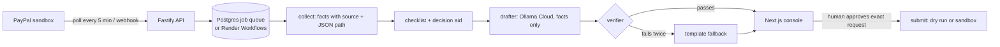

# Dispute Shield

An open-source dispute desk for small PayPal sellers. It answers disputes with evidence where every sentence cites a PayPal or seller record and passes a deterministic verifier, and it flags order gaps (no tracking, address mismatch, no seller protection) before they turn into disputes. Nothing is sent to PayPal without a human approving the exact request. **PayPal sandbox only.**

Built for "Build What's Next with PayPal and AI" (Devpost).

## Quickstart (replay mode, no PayPal account needed)

Needs Node 24, pnpm 11 and Docker.

```sh
pnpm install
cp .env.example .env            # replay mode + dry-run submit by default
docker compose up -d            # Postgres on localhost:5432
pnpm seed:demo                  # migrates and loads the demo shop
pnpm dev                        # web on http://localhost:3000, API on :4000
```

Sign in with `DS_DEMO_ACCESS_CODE` from `.env`. Add `OLLAMA_API_KEY` and `LLM_MODEL` (we use `gemma4:31b`) for AI drafts; without them DS-001 and DS-003 show a recorded model draft (labelled), other drafts use plain templates, and everything else works.

### The demo shop (Hearthside Ceramics)

| ID             | Situation                                                                 | What to look at                                                                 |
| -------------- | ------------------------------------------------------------------------- | ------------------------------------------------------------------------------- |
| DS-001         | Item not received, tracked and delivered                                  | Verified draft with citations → Approve → dry run stored with the exact request |
| DS-002         | Item not received, no tracking, due in hours                              | Needs info → upload the demo CSV on Fulfilment → Re-collect → Ready             |
| DS-003         | Credit not processed, refund already issued                               | Proof-of-refund draft                                                           |
| DS-004         | Unauthorised payment                                                      | No drafting for this reason: manual packet, accept-claim option                 |
| RISK-001 / 002 | Unprotected payment with address mismatch; paid 50 h ago with no tracking | Risk page: add tracking, refund or dismiss                                      |

## How it works



- **The model sees facts, not payloads,** and must cite fact keys for every statement. The verifier rejects any number, date, ID or claim not present in the cited facts; one repair attempt each for unparseable output and verifier failures, then a fixed template.
- **No win probabilities.** "Strength" is a checklist result from your records.
- **Money is integer minor units** end to end. Tracking and refund writes carry `PayPal-Request-Id`; dispute responses are stored as one submission per approval, so a retry cannot send twice. Every action lands in an append-only audit log.

| Path                | What                                                                                     |
| ------------------- | ---------------------------------------------------------------------------------------- |
| `apps/web`          | Next.js console (UI only): queue, case workspace, risk, health, fulfilment, audit, setup |
| `apps/api`          | Fastify: REST, sessions, webhook, cron tick, OpenAPI                                     |
| `apps/workflows`    | Render Workflows tasks running the same handlers                                         |
| `apps/cli`          | `ds seed:demo`, `ds replay-check`, `ds eval:live`, Day-0 spikes                          |
| `packages/core`     | facts, checklists, verifier, decision aid, risk rules, state machines (no frameworks)    |
| `packages/pipeline` | job handlers and case services shared by the API worker and Render                       |
| `packages/paypal`   | gateway (live + replay), submission builders                                             |
| `packages/agent`    | Ollama client, drafter                                                                   |
| `packages/db`       | Drizzle schema, migrations (RLS, append-only audit), repos, job queue                    |
| `packages/ui`       | design tokens, components, AG Grid wrapper, dashboard views                              |

## Verifier evals

`pnpm eval` runs hand-written model outputs through the real verifier, with no model needed; it also runs in CI, so one adversarial case getting through fails the build.

| Suite       | Cases                                                                                                                                                                                                                                            | Result        |
| ----------- | ------------------------------------------------------------------------------------------------------------------------------------------------------------------------------------------------------------------------------------------------ | ------------- |
| Golden      | 16 true statements over the DS-001 and DS-003 facts (date and money formats, refunds, injection text inside fact data), plus the template draft for both                                                                                         | 100% accepted |
| Adversarial | 15: fabricated tracking number, invented carrier, future and shifted dates, rounded amount, "buyer confirmed receipt", another case's facts, real key with unrelated text, injected instructions, "refunded" citing no refund, too long, uncited | 100% rejected |

`pnpm ds eval:live` runs the real drafter on the seeded demo facts and writes `docs/evals/<date>.md`. On [2026-10-18](docs/evals/2026-10-18.md) with `gemma4:31b`, 5 runs per draftable scenario plus a prompt-injection variant: schema-valid on the first try 100% (15/15), accepted after at most one repair 100% (15/15), injected instructions accepted 0, and a manual read of every accepted statement found no fabricated claim.

Without an AI key, replay mode shows a recorded `gemma4:31b` draft for DS-001 and DS-003 (`packages/fixtures/src/recorded-drafts.ts`), labelled "Recorded model output". The verifier still checks it against the current facts, and any mismatch falls back to the template.

## Commands

```sh
pnpm turbo run lint typecheck test   # all checks
pnpm openapi:export                  # writes docs/openapi.json (CI runs openapi:check)
pnpm ds replay-check                 # fixtures parse against @ds/schemas, no unredacted emails
pnpm eval                            # verifier evals (deterministic)
pnpm ds eval:live                    # live-model eval, needs OLLAMA_API_KEY and LLM_MODEL
pnpm ds eval:live --runs 1 --record  # also re-record the replay-mode model drafts
pnpm test:e2e                        # Playwright, replay mode, own servers and ds_e2e database
node scripts/check-bundle-secrets.mjs  # after a web build: no secret value in the bundle
```

## Going live in the sandbox

Set `DS_MODE=live`, `PAYPAL_CLIENT_ID` and `PAYPAL_CLIENT_SECRET` for a sandbox REST app with Disputes and Transaction search enabled. Keep `DS_SUBMIT_MODE=dry-run` until you have reviewed a stored request; `live` sends approved requests to the sandbox. Use the Supabase **session** pooler (port 5432), not the transaction pooler.

## Limits

- Drafts evidence for item-not-received and refund cases only; other reasons get a manual fact packet.
- The sandbox did not emit real dispute webhooks in our tests, so polling is the source of truth.
- Transaction Search data can be up to 3 hours old.

## Docs

Specs live in `docs/` (start with `docs/architecture.md`); `docs/agent-pack.md` is the index of the planning pack. Licence: MIT (`LICENSE`).
