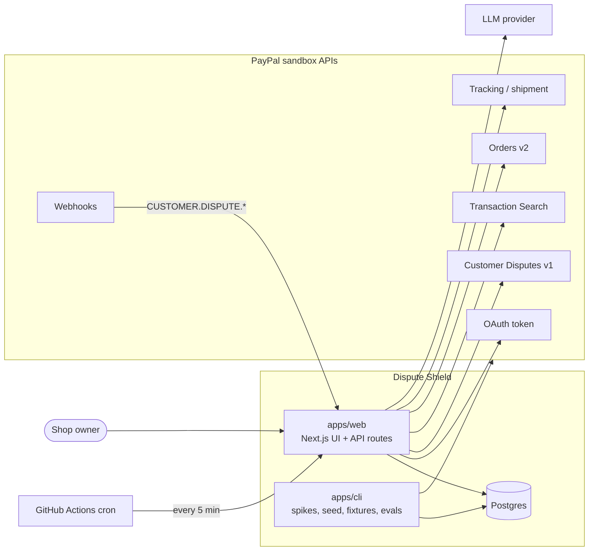
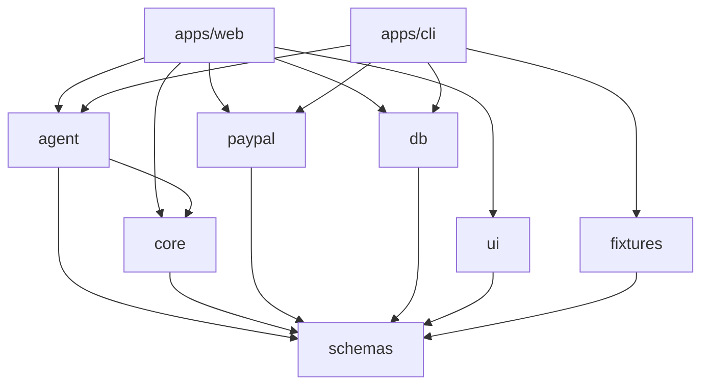
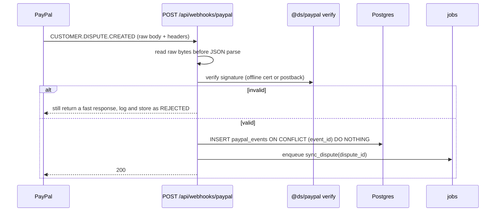
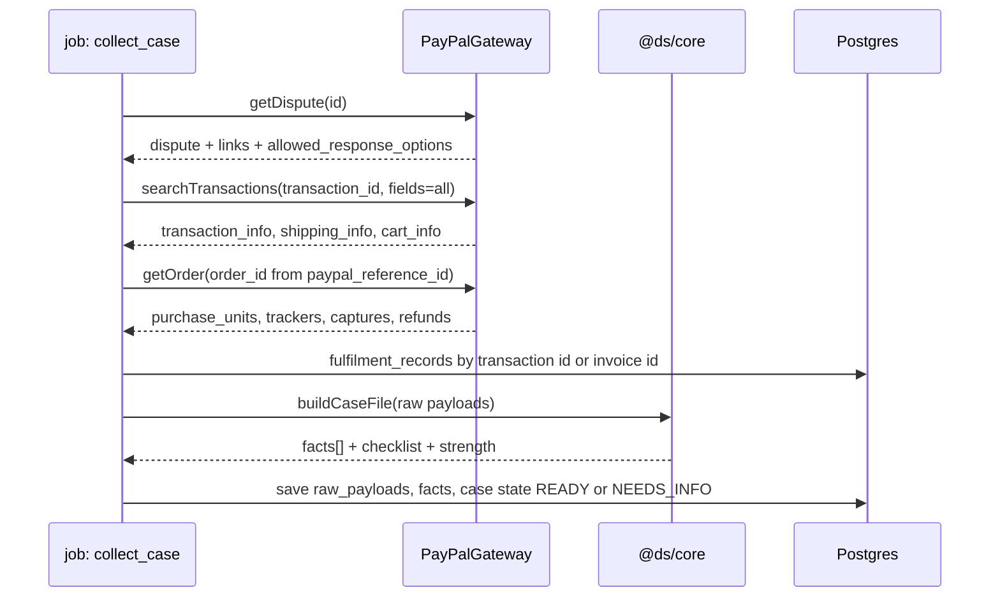
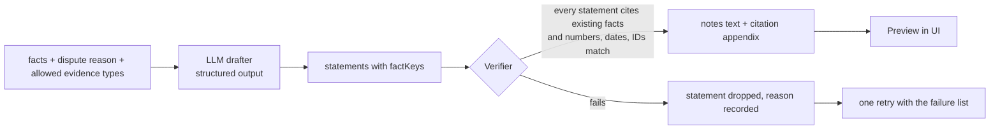
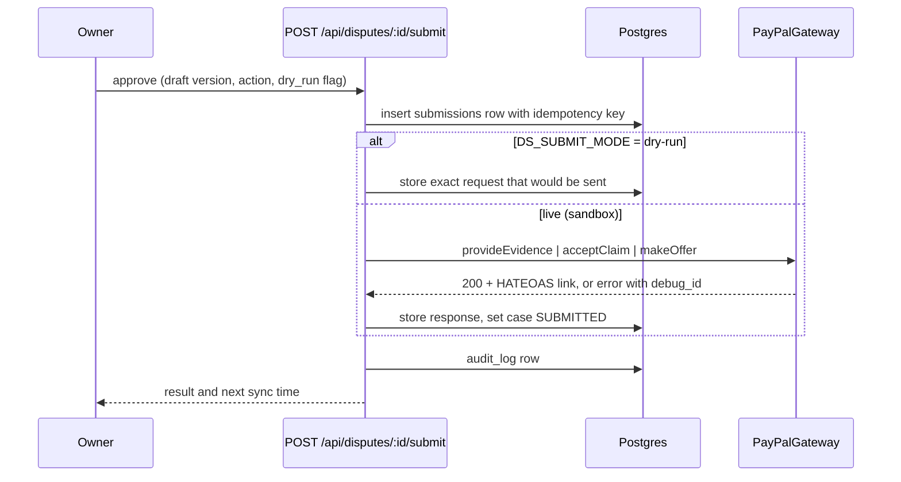
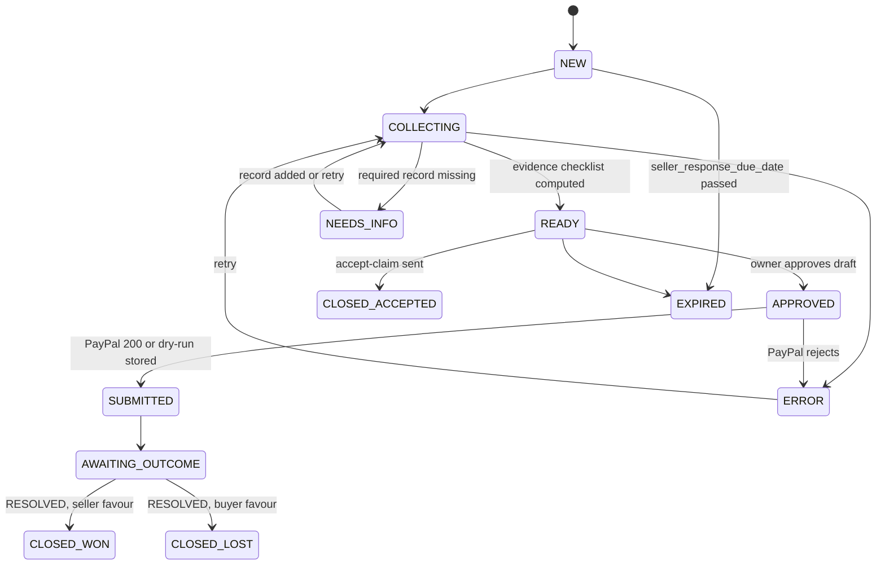

# Dispute Shield: Architecture

Status: draft v1, written 2026-10-17 (IST) for the PayPal AI Hackathon (submission closes 2026-11-13 01:30 IST).
Audience: the builder(s) and any coding agent working in the Turborepo.
Companion files: `02-monorepo-structure.md`, `03-paypal-api-contract.md`, `04-data-model.md`, `05-evidence-engine-spec.md`, `06-ui-spec.md`, `07-implementation-plan.md`.

## 0. Verification legend

Every PayPal or tooling fact in this pack carries one of three marks. Do not build on a fact marked ⚠️ or ❓ until a Day-0 spike (`11-risks-and-day0-spikes.md`) has confirmed it and the raw response is saved as a fixture.

| Mark | Meaning |
| --- | --- |
| ✅ | Read in PayPal, AG Grid or Turborepo documentation on 2026-10-17. Source listed in `03-paypal-api-contract.md`. |
| ⚠️ | Written from memory or from a third-party page. Likely right, not confirmed. |
| ❓ | Unknown or the docs conflict. Needs a spike. |

## 1. Purpose and scope

Dispute Shield is an open-source dispute desk for small online sellers who take payments with PayPal. It does two jobs:

1. **Respond.** When a buyer opens a dispute, build a case file from PayPal's own records, draft evidence in which every sentence cites a record, recommend fight or accept, and submit after the owner approves.
2. **Prevent.** Scan recent captured payments for the patterns that lose disputes (not fully seller-protected, no tracking, ship-to mismatch, stuck delivery) and offer a fix before a dispute opens.

Named user: the owner or ops person of a small online shop. Decisions: ship or hold an order; fight or accept a dispute.

Non-goals for the hackathon build: multi-tenant onboarding, live (production) PayPal calls, card-network chargebacks outside PayPal, ML win-probability, Shopify or other store connectors.

## 2. System context



## 3. Principles

1. **Facts are deterministic; prose is generated; a verifier gates the prose.** The model never supplies a fact. It arranges facts that code fetched from PayPal.
2. **Every claim cites a fact key.** A claim without a valid citation is dropped, not softened.
3. **Human approval before anything leaves the system.** No evidence, offer, refund or acceptance is sent without an explicit approve action.
4. **Ports and adapters at the PayPal boundary.** One `PayPalGateway` interface with a live adapter and a replay adapter. The same app runs against the sandbox or against recorded fixtures.
5. **Sandbox only.** The client hard-codes `https://api-m.sandbox.paypal.com`. There is no production switch.
6. **Webhooks are a hint, not the truth.** PayPal can deliver late, twice or out of order. Handlers store the event, then re-read current state from the API.
7. **Pure core.** Domain logic lives in `@ds/core` with no I/O so it can be tested in milliseconds.
8. **No invented numbers.** The UI shows amount at risk, due time and evidence coverage. It never shows a win probability.

## 4. Containers and packages

| Unit | Path | Responsibility | May import |
| --- | --- | --- | --- |
| `@ds/web` | `apps/web` | Next.js app: UI, route handlers, webhook endpoint, cron tick endpoint | all packages |
| `@ds/cli` | `apps/cli` | `ds` command: Day-0 spikes, sandbox seeding, fixture record and replay, eval runner | all packages |
| `@ds/schemas` | `packages/schemas` | zod schemas and inferred types for facts, drafts, API payloads, PayPal payload subsets | none |
| `@ds/core` | `packages/core` | Case-file builder, fact extraction, evidence checklists, verifier, decision aid, risk rules, state machines | `@ds/schemas` |
| `@ds/paypal` | `packages/paypal` | REST client, gateway interface, live and replay adapters, webhook verification, error taxonomy | `@ds/schemas` |
| `@ds/db` | `packages/db` | Drizzle schema, migrations, repositories, job queue helpers | `@ds/schemas` |
| `@ds/agent` | `packages/agent` | LLM drafter, prompts, case copilot, PayPal toolkit wiring, eval harness | `@ds/schemas`, `@ds/core` |
| `@ds/ui` | `packages/ui` | Design tokens, React components, AG Grid and AG Studio wrappers, custom widgets | `@ds/schemas` |
| `@ds/fixtures` | `packages/fixtures` | Redacted PayPal payloads, demo shop data, seed builders | `@ds/schemas` |
| `@ds/config-typescript` | `packages/config-typescript` | Shared `tsconfig` bases | none |
| `@ds/config-eslint` | `packages/config-eslint` | Shared flat ESLint config and boundary rules | none |

### 4.1 Dependency rules



- `@ds/core` and `@ds/schemas` must never import `@ds/paypal`, `@ds/db`, `@ds/agent` or any framework. Enforce with ESLint `no-restricted-imports` or `eslint-plugin-boundaries`.
- `@ds/ui` must not import server-only packages.
- Apps compose packages; packages never import apps.

## 5. Key flows

### 5.1 Webhook intake



Notes:
- The PayPal page says to treat a notification as valid only when `verification_status` is `SUCCESS` ✅. The same page's text and its Node example disagree on the HTTP code to return when verification fails ❓. Decision: store the event as `REJECTED`, return 400, and rely on polling for the real state.
- Deduplicate on the event `id` with an atomic insert, not check-then-write ⚠️ (third-party guidance).
- Events can arrive out of order ⚠️, so the job re-reads the dispute with `GET /v1/customer/disputes/{id}` and never trusts the event body for state.
- Polling fallback: the cron tick lists disputes updated since the last sync (`update_time_after` ✅ parameter name, format ❓) so a missed webhook is recovered within five minutes.

### 5.2 Case collection (deterministic)



Each call stores its untouched response in `raw_payloads`. Facts point back to a payload and a JSON path, so a citation can always be traced to bytes PayPal returned.

Order lookup: the disputed ID is a transaction (capture) ID, not an order ID. The order ID comes from `transaction_info.paypal_reference_id` when `paypal_reference_id_type` is `ODR` ✅.

### 5.3 Draft and verify



Full rules are in `05-evidence-engine-spec.md`.

### 5.4 Approve and submit



Before sending, the handler re-reads the dispute and checks that the matching HATEOAS link (`provide-evidence`, `accept-claim`, `make-offer`) is present. If the link is missing the action is refused ✅ (PayPal says you cannot provide evidence without it).

### 5.5 Prevent scan

1. Cron or the "Scan now" button lists recent transactions with `GET /v1/reporting/transactions` (max 31 days per call, up to three hours of delay) ✅.
2. For each transaction not yet scanned, load `shipping_info`, `cart_info` and `protection_eligibility`.
3. Join the merchant's fulfilment record.
4. `@ds/core` evaluates rules R-PROT, R-ADDR, R-NOTRACK, R-STUCK, R-HIGH (thresholds in `05-evidence-engine-spec.md`) and writes `risk_flags`.
5. The owner picks an action per flag: add tracking, refund before dispute, dismiss. Each action goes through the same approve and audit path as a dispute submission.

### 5.6 Case copilot (should-have)

A chat panel on the case page. It runs a tool-using model with PayPal read tools from `@paypal/agent-toolkit` restricted to `get_dispute`, `get_order`, `get_shipment_tracking`, `list_transactions` ✅ (names). Every tool result is written to `raw_payloads` and turned into facts, so the copilot's answers cite fact keys and pass through the same verifier. The copilot cannot write to PayPal.

## 6. Evidence pipeline data shapes

```ts
// @ds/schemas
export type Fact = {
  key: string;            // e.g. "txn.protection_eligibility", "tracking.number"
  label: string;          // human label shown in the UI
  value: string | number | boolean | null;
  display: string;        // exact string the verifier matches against
  sourcePayloadId: string;
  jsonPath: string;       // path inside the stored raw payload
  fetchedAt: string;      // ISO 8601
};

export type EvidenceStatement = {
  text: string;           // one sentence, no new facts
  factKeys: string[];     // at least one, all must exist in the case
};

export type EvidenceDraft = {
  evidenceType: "PROOF_OF_FULFILLMENT" | "PROOF_OF_REFUND" | "OTHER";
  statements: EvidenceStatement[];
  recommendation: {
    action: "FIGHT" | "ACCEPT" | "REVIEW";
    rationale: EvidenceStatement[];
  };
};

export type VerifierReport = {
  accepted: EvidenceStatement[];
  rejected: { statement: EvidenceStatement; reason: "NO_CITATION" | "UNKNOWN_FACT" | "VALUE_MISMATCH" | "TOO_LONG" }[];
  notesText: string;      // accepted statements joined, max 2000 chars
  citationAppendix: { factKey: string; label: string; display: string; payloadId: string; jsonPath: string }[];
};
```

`evidenceType` values are the three PayPal documents list ✅. The 2000-character limit on `notes` comes from PayPal's guide ✅.

## 7. PayPal gateway

```ts
// @ds/paypal
export interface PayPalGateway {
  listDisputes(q: { updateTimeAfter?: string; disputeState?: string; page?: number; pageSize?: number; nextPageToken?: string }): Promise<Raw<DisputeList>>;
  getDispute(id: string): Promise<Raw<DisputeDetails>>;
  provideEvidence(id: string, input: ProvideEvidenceInput, files?: EvidenceFile[]): Promise<Raw<Subsequent>>;
  acceptClaim(id: string, input: AcceptClaimInput): Promise<Raw<Subsequent>>;
  makeOffer(id: string, input: MakeOfferInput): Promise<Raw<Subsequent>>;
  searchTransactions(q: TxnQuery): Promise<Raw<TxnPage>>;
  getOrder(id: string): Promise<Raw<Order>>;
  addTracking(orderId: string, input: AddTrackingInput): Promise<Raw<unknown>>;       // path ⚠️
  refundCapture(captureId: string, input: RefundInput): Promise<Raw<unknown>>;       // path ⚠️
  verifyWebhook(headers: Headers, rawBody: string): Promise<{ ok: boolean; reason?: string }>;
}
// Raw<T> = { status: number; headers: Record<string,string>; body: T; debugId?: string; recordedAt: string }
```

Adapters:
- **LiveGateway**: OAuth client-credentials with token cache (sandbox tokens last about 3 to 8 hours ✅), refresh on 401, retry with exponential backoff on 429 and 5xx, honour `debug_id` from error bodies ✅ (error schema has `name`, `message`, `debug_id`), redact secrets in logs, optional recorder that writes each call to `packages/fixtures`.
- **ReplayGateway**: serves fixtures chosen by `(operation, scenario key)`. Scenario comes from `DS_SCENARIO` or the dispute ID. Lets judges run the full flow without PayPal credentials, and protects the demo from sandbox outages.

Error taxonomy: `AuthError`, `PermissionError` (403, missing scope), `NotFound`, `ValidationError` (400 with `details[]`), `RateLimited`, `UpstreamError`, `LinkMissing` (HATEOAS link absent).

## 8. State machines

### 8.1 Case



The PayPal dispute `status` (OPEN, WAITING_FOR_SELLER_RESPONSE, WAITING_FOR_BUYER_RESPONSE, UNDER_REVIEW, RESOLVED ✅) is stored separately in `disputes.paypal_status`. The case state is Dispute Shield's own workflow state and never overwrites it.

### 8.2 Submission

`PENDING → SENT | DRY_RUN_STORED | FAILED`. A failed submission keeps the PayPal `debug_id` and can be retried with the same idempotency key.

## 9. Jobs

A `jobs` table in Postgres, no Redis.

- Claim with `SELECT ... FOR UPDATE SKIP LOCKED`, `attempts` counter, `run_after` for backoff, `locked_by` and `locked_at` for crash recovery.
- Job kinds: `sync_disputes`, `sync_dispute`, `collect_case`, `draft_case`, `scan_transactions`, `record_fixture`.
- Runners: `POST /api/cron/tick` (protected by `CRON_SECRET`) processes due jobs for up to a fixed time budget and re-enqueues `sync_disputes`. A scheduled GitHub Actions workflow calls it every five minutes ⚠️ (GitHub's minimum cron interval). The webhook handler and the UI "Sync now" button call the same function.
- Every job is idempotent: re-running `collect_case` replaces facts for the same case version.

## 10. LLM layer

- Provider-agnostic through the Vercel AI SDK; default provider and model from `LLM_PROVIDER` and `LLM_MODEL`. Exact SDK function names change between major versions, so check the installed version before coding ❓. The PayPal toolkit README snippet uses `generateText` with `maxSteps` ✅, which suggests an older AI SDK major; confirm compatibility in spike S9.
- The drafter gets only facts (key, label, display), the dispute reason, the allowed evidence types and a style guide. It does not get raw payloads or buyer personal data.
- Output is schema-constrained (zod). One repair retry with the verifier's rejection list, then fail closed to a template sentence set built from facts without a model.
- Prompts live in `packages/agent/src/prompts/` with a version string stored on each `drafts` row.
- Evals (`pnpm eval`): golden cases and adversarial cases (fabricated tracking number, wrong date, missing citation). The verifier must reject every fabricated case.

## 11. Frontend

- Next.js App Router. Versions to match PayPal's AG Studio starter on 2026-10-17: `next` 16.3.6, `react` 19.2.8, `ag-grid-community` and `ag-grid-react` 36.2.0, `ag-studio` and `ag-studio-react` 3.0.0, Tailwind 4, TypeScript 5 ✅ (starter's `package.json`).
- Server components fetch through repositories in `@ds/db`; mutations use server actions or route handlers validated with `@ds/schemas`.
- AG Grid powers the dispute queue and risk radar. AG Studio powers the Dispute Health dashboard (custom widgets and theming are what its prize judges look at ✅). AG Studio takes arrays of plain objects as data sources with an `id` ✅.
- Auth: single tenant. `DS_DEMO_ACCESS_CODE` gates the hosted demo with a cookie. There is no sign-up flow. Production-grade merchant onboarding is a roadmap item, not a build item.
- Screens and behaviour: `06-ui-spec.md`.

## 12. Security and privacy

- Secrets only in environment variables; `.env.example` lists names, never values. CI fails on committed secrets.
- Sandbox only. The client has no production base URL; `DS_MODE=live` still talks to the sandbox.
- Raw payloads contain buyer data. Store only what the case needs; fixtures are redacted (names, emails, addresses replaced with synthetic values) before commit.
- The LLM sees fact displays, not raw payloads. Buyer names and emails are not included in prompts.
- Logs never contain tokens, client secrets or full payloads. Log PayPal `debug_id` instead.
- Webhooks: verify signature, reject unverified, deduplicate on event ID.
- Cron and webhook endpoints: secret or signature required; rate-limit by IP.
- Audit log rows are append-only (`audit_log`), written for every approve, submit, refund, add-tracking, dismiss and settings change.

## 13. Observability

- Structured logs (`pino`) with `requestId`, `jobId`, `disputeId`.
- `GET /api/health` reports mode (`live` or `replay`), submit mode, last sync time, last webhook time, LLM reachability.
- The UI Setup page shows the same data so a judge can see at a glance that the app is wired to the sandbox.

## 14. Deployment

| Profile | Web | Database | Scheduler | Notes |
| --- | --- | --- | --- | --- |
| A, recommended | Vercel | Neon Postgres | GitHub Actions cron to `/api/cron/tick` | Check free-tier limits and that the database does not expire before judging ends on 2026-12-15 ⚠️. |
| B, local | `pnpm dev` | `docker compose up` Postgres | manual "Sync now" | What a judge runs from the README. Works in replay mode with no credentials. |

The hosted demo must stay up and free to use until the judging period ends (Dec 15) per the rules. Put a calendar reminder to check it on Dec 1 and Dec 10.

CI (`.github/workflows/ci.yml`): install, `turbo run lint typecheck test`, Playwright e2e in replay mode, secret scan. `cron-tick.yml` calls the tick endpoint.

## 15. Decision log

| ID | Decision | Alternatives | Why | Revisit if |
| --- | --- | --- | --- | --- |
| ADR-001 | Turborepo with pnpm workspaces | npm workspaces, Nx | Requested by the builder; simple task graph | Build times become a problem |
| ADR-002 | Internal packages consumed as source (just-in-time), `transpilePackages` in Next | Compiled packages with `build` | No build step per package; fastest iteration | A package needs publishing |
| ADR-003 | Postgres + Drizzle | SQLite | Row locking for jobs, JSONB for raw payloads, matches hosted DB | Zero-setup local run matters more than locking |
| ADR-004 | DB-backed jobs, cron via GitHub Actions | pg-boss, Redis/BullMQ, Vercel Cron | No extra infra, free, host-agnostic | Need sub-minute latency |
| ADR-005 | Direct REST client for disputes, tracking and refunds; toolkit only for the copilot's read tools | Toolkit for everything | The toolkit has no evidence or payouts tools (its dispute tools are `list_disputes`, `get_dispute`, `accept_dispute_claim`) ✅; REST depth is what the first judging criterion rewards | Toolkit adds evidence tools |
| ADR-006 | Citation-enforced drafting with a deterministic verifier | Free-form generation | Makes the "auditable" claim true and testable | None |
| ADR-007 | Replay adapter and fixtures from day one | Live only | Judges can run it; protects demo from sandbox flakiness | None |
| ADR-008 | No win probability | Model-estimated odds | Not defensible with no outcome data | We collect real outcomes |
| ADR-009 | Single tenant, access-code demo login | Full auth | Time; the rules need a working demo, not onboarding | Post-hackathon |
| ADR-010 | AG Grid Community for the queue from day one; AG Studio trial started late | Studio from day one | Trial is 45 days ✅ and judging runs to Dec 15; start it about Nov 1 so it covers judging | AG Grid confirms a longer licence |
| ADR-011 | Human approval required for every outbound action | Auto-submit | Safety, and a better story | None |
| ADR-012 | Fail closed to template evidence when the model fails | Fail open | An outage must not block a response deadline | None |

## 16. Open questions

Tracked with owners and spikes in `11-risks-and-day0-spikes.md`. The ones that can change the architecture:

1. Can a sandbox dispute be created and walked to `WAITING_FOR_SELLER_RESPONSE` without PayPal's account manager? (S1 to S3)
2. What is the exact multipart shape of `provide-evidence`? The guide describes an `input` JSON part plus document parts; the API schema shows a single binary field `evidence-file` ❓. (S3)
3. Do order details return trackers and capture or refund fields in the shape this design assumes? (S7)
4. Does AG Studio need a licence key at runtime in development, and what does it show when the trial lapses? ❓ (S10)

## 17. Glossary

- **Case**: Dispute Shield's workflow record for one PayPal dispute.
- **Fact**: one value extracted from a stored PayPal payload, with a key and a path back to the payload.
- **Statement**: one sentence of generated evidence that cites fact keys.
- **Verifier**: deterministic code that accepts or rejects statements.
- **Replay mode**: running the app against recorded fixtures instead of live sandbox calls.
- **Strength**: STRONG, MEDIUM or WEAK evidence coverage from a fixed checklist; not a probability.
