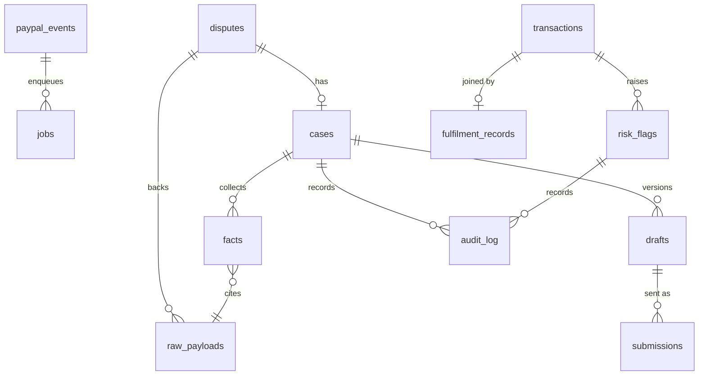

# 04. Data model

Postgres 16 (Supabase in the hosted demo; `docker compose` locally; only standard Postgres features are used), Drizzle ORM, migrations committed in `packages/db/drizzle/`. All timestamps are `timestamptz` (UTC). IDs generated by the app are `uuid` (v7 if available, otherwise v4) unless the row mirrors a PayPal ID, in which case the PayPal ID is the key. Money is stored as `amount_minor bigint` plus `currency char(3)`; PayPal's decimal strings are converted at the gateway edge with a currency-aware exponent table (JPY has 0 decimals, for example ⚠️ confirm the list of currencies PayPal supports in the sandbox).

Design rules:
1. **Raw first.** Every PayPal response we use is stored untouched in `raw_payloads` before it is normalised. Facts point to raw payloads, so the UI can show "where did this come from".
2. **Append, don't overwrite.** Drafts, submissions, audit rows and events are never updated except for their own status columns.
3. **No business rules in the DB layer.** Repos read and write; `@ds/core` decides.
4. **One tenant.** There is no `tenant_id`. Adding one later is a documented non-goal (`architecture.md` ADR-009).

## 1. Entity overview



## 2. Tables

### 2.1 `paypal_events`

Webhook inbox and idempotency guard.

| Column | Type | Notes |
| --- | --- | --- |
| `id` | text PK | PayPal event ID (`WH-…`); the primary key is the dedup mechanism |
| `event_type` | text not null | e.g. `CUSTOMER.DISPUTE.UPDATED` |
| `resource_id` | text | dispute ID when present |
| `received_at` | timestamptz not null default now() | |
| `verified` | boolean not null | result of signature verification |
| `verification_detail` | text | PayPal's `verification_status` or our error |
| `headers` | jsonb not null | the five PayPal headers, nothing else |
| `body_raw` | text not null | exact bytes as UTF-8 |
| `processed_at` | timestamptz | set when the follow-up job has been enqueued |

Insert with `ON CONFLICT (id) DO NOTHING RETURNING id`; no row returned means duplicate, answer 200 and stop. Unverified events are stored (with `verified=false`) for diagnosis but never enqueue work.

### 2.2 `raw_payloads`

| Column | Type | Notes |
| --- | --- | --- |
| `id` | uuid PK | |
| `source` | text not null | `paypal.dispute.details`, `paypal.dispute.list`, `paypal.txn.search`, `paypal.order.details`, `paypal.webhook`, `fulfilment.csv_row`, `toolkit.<tool>` |
| `ref` | text not null | dispute ID, transaction ID, order ID or CSV row key |
| `fetched_at` | timestamptz not null | |
| `payload` | jsonb not null | after secret redaction only (see `architecture.md` section 12) |
| `sha256` | char(64) not null | hash of canonical JSON; used to skip storing identical repeats |

Index: `(source, ref, fetched_at desc)`. Unique: `(source, ref, sha256)`.

### 2.3 `disputes`

Normalised mirror of PayPal's dispute (latest known state).

| Column | Type | Notes |
| --- | --- | --- |
| `id` | text PK | PayPal `dispute_id` |
| `reason` | text not null | PayPal reason code |
| `paypal_status` | text not null | `OPEN`, `WAITING_FOR_SELLER_RESPONSE`, … |
| `dispute_state` | text | PayPal's coarse state, nullable until known |
| `stage` | text not null | `INQUIRY`, `CHARGEBACK`, … |
| `amount_minor` | bigint not null | |
| `currency` | char(3) not null | |
| `disputed_transaction_id` | text | the seller-side transaction ID |
| `buyer_masked` | text | display name only, as PayPal returns it (no email) |
| `created_at_paypal` | timestamptz | |
| `updated_at_paypal` | timestamptz | |
| `seller_response_due` | timestamptz | null when not waiting on the seller |
| `allowed_actions` | text[] not null default '{}' | derived from `links` and `allowed_response_options` |
| `latest_payload_id` | uuid FK raw_payloads | |
| `synced_at` | timestamptz not null | |

Indexes: `(paypal_status)`, `(seller_response_due)`, `(disputed_transaction_id)`.

### 2.4 `cases`

Our workflow wrapper around a dispute.

| Column | Type | Notes |
| --- | --- | --- |
| `id` | uuid PK | |
| `dispute_id` | text unique FK disputes | |
| `state` | text not null | see state machine below |
| `strength` | text | `STRONG`, `MEDIUM`, `WEAK`, null before collection |
| `checklist` | jsonb | array of `{key, label, status: MET|MISSING|NOT_APPLICABLE, factKeys[]}` |
| `recommended_action` | text | `PROVIDE_EVIDENCE`, `ACCEPT_CLAIM`, `MANUAL` |
| `needs_info` | jsonb | what is missing and who can supply it |
| `opened_at` | timestamptz not null | |
| `closed_at` | timestamptz | |
| `outcome_note` | text | PayPal outcome text when resolved |
| `error_detail` | text | last error when state = ERROR |

### 2.5 `facts`

| Column | Type | Notes |
| --- | --- | --- |
| `id` | uuid PK | |
| `case_id` | uuid FK cases | |
| `key` | text not null | e.g. `tracking.number` |
| `label` | text not null | human label shown in the UI |
| `value` | jsonb not null | typed value (string, number, boolean or null) |
| `display` | text not null | exact string shown and used by the verifier |
| `source_payload_id` | uuid FK raw_payloads | |
| `source_path` | text | JSON path inside the payload |
| `confidence` | text not null | `PAYPAL` (came from PayPal), `SELLER_UPLOAD` (CSV), `DERIVED` (computed) |
| `collected_at` | timestamptz not null | |

Unique: `(case_id, key, collected_at)`. Facts are append-only; the current set is the latest row per key. The verifier only uses the latest set.

### 2.6 `drafts`

| Column | Type | Notes |
| --- | --- | --- |
| `id` | uuid PK | |
| `case_id` | uuid FK cases | |
| `version` | int not null | monotonic per case |
| `origin` | text not null | `MODEL`, `TEMPLATE_FALLBACK`, `HUMAN_EDIT` |
| `model` | text | model identifier used |
| `prompt_version` | text | e.g. `drafter.v1` |
| `content` | jsonb not null | the full `EvidenceDraft` (`evidenceType`, `statements[]`, `recommendation`); for `HUMAN_EDIT` the edited statements |
| `notes_text` | text not null | final text sent as evidence notes (≤ 2000 chars) |
| `verifier_report` | jsonb not null | `VerifierReport` |
| `verifier_passed` | boolean not null | |
| `created_at` | timestamptz not null | |
| `created_by` | text not null | `system` or `owner` |

Unique: `(case_id, version)`.

### 2.7 `submissions`

| Column | Type | Notes |
| --- | --- | --- |
| `id` | uuid PK | |
| `case_id` | uuid FK cases | |
| `draft_id` | uuid FK drafts | |
| `action` | text not null | `PROVIDE_EVIDENCE`, `ACCEPT_CLAIM`, `MAKE_OFFER`, `ADD_TRACKING`, `REFUND` |
| `status` | text not null | `PENDING`, `SENT`, `DRY_RUN_STORED`, `FAILED` |
| `request_snapshot` | jsonb not null | exactly what would be/was sent (secrets excluded, files listed by name and hash) |
| `response_snapshot` | jsonb | PayPal's response or error |
| `idempotency_key` | text not null unique | `PayPal-Request-Id` we generated |
| `approved_by` | text not null | |
| `approved_at` | timestamptz not null | |
| `sent_at` | timestamptz | |
| `error_detail` | text | |

Hard rule enforced in a repo method and by a DB check: a submission row can only be created with `approved_at` and a `draft_id` whose `verifier_passed` is true, unless `action` is `ACCEPT_CLAIM` (no draft needed; `draft_id` nullable only for that action).

### 2.8 `transactions`

Seller-side transactions from Transaction Search, used by Prevent.

| Column | Type | Notes |
| --- | --- | --- |
| `id` | text PK | PayPal transaction ID |
| `order_id` | text | from `paypal_reference_id` when type is ODR |
| `capture_id` | text | when known (S7) |
| `invoice_id` | text | |
| `custom_field` | text | |
| `occurred_at` | timestamptz not null | |
| `amount_minor` | bigint not null | |
| `currency` | char(3) not null | |
| `status` | text | PayPal `transaction_status` |
| `protection_eligibility` | text | `01`, `02`, `03` |
| `ship_to_name` | text | |
| `ship_to_line1` | text | |
| `ship_to_city` | text | |
| `ship_to_postal` | text | |
| `ship_to_country` | text | |
| `items` | jsonb | from `cart_info` |
| `payload_id` | uuid FK raw_payloads | |
| `fetched_at` | timestamptz not null | data can be 3 hours old |

Personal data minimisation: ship-to columns exist because the address-mismatch rule needs them; the demo uses synthetic data only (`architecture.md` section 12).

### 2.9 `fulfilment_records`

Imported from the seller's CSV (columns fixed in `05-evidence-engine-spec.md` section 2.4).

| Column | Type |
| --- | --- |
| `id` | uuid PK |
| `order_ref` | text not null |
| `paypal_transaction_id` | text not null (unique) |
| `carrier` | text |
| `tracking_number` | text |
| `shipped_at` | timestamptz |
| `delivered_at` | timestamptz |
| `last_scan_at` | timestamptz |
| `ship_to_name`, `ship_to_line1`, `ship_to_city`, `ship_to_postal`, `ship_to_country` | text |
| `imported_at` | timestamptz not null |
| `import_batch` | uuid not null |

Importing the same `paypal_transaction_id` again replaces the row and writes an audit entry.

### 2.10 `risk_flags`

| Column | Type | Notes |
| --- | --- | --- |
| `id` | uuid PK | |
| `transaction_id` | text FK transactions | |
| `rule` | text not null | `R-PROT`, `R-ADDR`, `R-NOTRACK`, `R-STUCK`, `R-HIGH` |
| `severity` | text not null | `LOW`, `MEDIUM`, `HIGH` |
| `reason` | text not null | one sentence, rendered from facts |
| `fact_refs` | jsonb not null | keys and values the rule used |
| `status` | text not null | `OPEN`, `ACTIONED`, `DISMISSED`, `AUTO_CLEARED` |
| `suggested_action` | text | `ADD_TRACKING`, `REFUND`, `REVIEW` |
| `first_seen_at` | timestamptz not null | |
| `resolved_at` | timestamptz | |

Unique: `(transaction_id, rule)` while status = `OPEN` (partial unique index). Re-scans update `reason` and `fact_refs` or set `AUTO_CLEARED` when the condition no longer holds.

### 2.11 `audit_log`

| Column | Type | Notes |
| --- | --- | --- |
| `id` | bigserial PK | |
| `at` | timestamptz not null default now() | |
| `actor` | text not null | `system`, `owner`, `webhook`, `cron`, `cli` |
| `action` | text not null | `CASE_OPENED`, `FACTS_COLLECTED`, `DRAFT_CREATED`, `VERIFIER_FAILED`, `APPROVED`, `SUBMITTED`, `DRY_RUN_STORED`, `FLAG_ACTIONED`, `FLAG_DISMISSED`, `CSV_IMPORTED`, `MODE_CHANGED`, `LOGIN`, … |
| `case_id` | uuid | nullable |
| `dispute_id` | text | nullable |
| `flag_id` | uuid | nullable |
| `detail` | jsonb | small structured detail; never tokens or full payloads |

Revoke UPDATE and DELETE on this table for the application role in the migration.

### 2.12 `jobs`

| Column | Type | Notes |
| --- | --- | --- |
| `id` | uuid PK | |
| `kind` | text not null | `sync_disputes`, `sync_dispute`, `collect_case`, `draft_case`, `scan_transactions`, `record_fixture` |
| `payload` | jsonb not null default '{}' | e.g. `{ "disputeId": "PP-D-…" }`; validated by `@ds/jobs` before a handler runs. Ids only, never data |
| `backend` | text not null default 'postgres' | `postgres` or `render`. With `render` the row is a record only: the work runs as a Render Workflows task and this row stores the outcome for the Setup page |
| `external_run_id` | text | Render task run id when `backend='render'` |
| `dedupe_key` | text | e.g. `sync_dispute:PP-D-…`; partial unique index while status in (QUEUED, RUNNING) |
| `status` | text not null | `QUEUED`, `RUNNING`, `DONE`, `FAILED`, `DEAD` |
| `run_at` | timestamptz not null default now() | |
| `attempts` | int not null default 0 | |
| `max_attempts` | int not null default 5 | |
| `locked_at` | timestamptz | |
| `last_error` | text | |
| `created_at` / `finished_at` | timestamptz | |

Claim query (pattern; applies to `backend='postgres'`). It relies on row locks held inside a transaction, so connect through the Supabase **session pooler or the direct connection**, never the transaction pooler (port 6543):

```sql
UPDATE jobs SET status='RUNNING', locked_at=now(), attempts=attempts+1
WHERE id IN (
  SELECT id FROM jobs
  WHERE status='QUEUED' AND run_at <= now()
  ORDER BY run_at
  FOR UPDATE SKIP LOCKED
  LIMIT $1
)
RETURNING *;
```

Retry: exponential backoff (`run_at = now() + 2^attempts minutes`, capped at 30), `DEAD` after `max_attempts`. A reaper in the tick requeues `RUNNING` jobs whose `locked_at` is older than 10 minutes.

### 2.12a Analytics views (no PII)

The AG Studio dashboard reads four views through `GET /api/analytics/:source` (`14-prize-tracks.md` section 2.3). Views, not tables, so the allow-list of columns is explicit and reviewable. Money stays in minor units.

| View | One row per | Columns |
| --- | --- | --- |
| `v_analytics_disputes` | dispute | `id`, `reason`, `paypal_status`, `case_state`, `amount_minor`, `currency`, `seller_response_due`, `hours_to_due`, `strength`, `verifier_passed` |
| `v_analytics_evidence_items` | checklist item per case | `dispute_id`, `item_key`, `status`, `required` |
| `v_analytics_statements` | draft statement (latest draft per case) | `dispute_id`, `accepted`, `reject_reason`, `fact_key_count` |
| `v_analytics_risk_flags` | risk flag | `rule`, `order_value_minor`, `currency`, `status`, `created_at` |

No view includes buyer names, emails, addresses, tracking numbers, free text or raw payloads. A test asserts the column allow-list (AC-STUDIO-01).

### 2.13 `settings`

Key-value (`key text PK`, `value jsonb`, `updated_at`). Keys: `risk.thresholds`, `ui.timezone`, `sync.last_dispute_cursor`, `sync.last_webhook_at`, `mode.last_changed`, `shop.profile` (name, return-policy text used in drafts).

## 3. Case state machine (persisted in `cases.state`)

| From | Event | To | Guard |
| --- | --- | --- | --- |
| – | dispute seen with seller action possible | `NEW` | |
| `NEW` | `collect_case` job starts | `COLLECTING` | |
| `COLLECTING` | facts complete enough to draft | `READY` | checklist has no blocking MISSING |
| `COLLECTING` | blocking items missing | `NEEDS_INFO` | |
| `NEEDS_INFO` | owner imports CSV or confirms facts, re-collect | `COLLECTING` | |
| `READY` | owner approves a verified draft | `APPROVED` | `verifier_passed` and not past deadline |
| `READY` | owner chooses accept claim and confirms | `APPROVED` | |
| `APPROVED` | submission sent or stored | `SUBMITTED` | submission status SENT or DRY_RUN_STORED |
| `SUBMITTED` | PayPal status becomes UNDER_REVIEW / WAITING_FOR_BUYER_RESPONSE | `AWAITING_OUTCOME` | |
| `AWAITING_OUTCOME` | resolved in seller's favour | `CLOSED_WON` | |
| `AWAITING_OUTCOME` | resolved in buyer's favour | `CLOSED_LOST` | |
| any open state | owner accepted claim and PayPal resolves | `CLOSED_ACCEPTED` | |
| any open state | `seller_response_due` passed with no submission | `EXPIRED` | |
| any | unrecoverable error | `ERROR` | `error_detail` set |
| `ERROR` | owner retries | `COLLECTING` | |

Transitions are implemented in `packages/core/src/state/case-machine.ts` as a pure function `next(state, event, ctx)` returning the new state or a typed refusal. The repo layer refuses to persist a state the machine did not produce.

PayPal-driven transitions come from re-fetched dispute details, never from the webhook payload alone.

## 4. Submission state machine

`PENDING` → `SENT` (live mode, 2xx) | `DRY_RUN_STORED` (dry-run) | `FAILED` (non-2xx or exception). `FAILED` never auto-retries; the owner presses "Retry", which creates a new submission row with a new idempotency key linked to the same draft.

## 5. Migration and seed policy

- `pnpm db:generate` after any schema change; commit the SQL. Never edit a generated migration; add a new one.
- `pnpm seed:demo` is idempotent: truncates demo tables inside one transaction and reloads from `@ds/fixtures`. It refuses to run if `DS_MODE=live` and the database contains rows with non-fixture IDs, unless `--force` is passed.
- Test databases: each Vitest integration file creates a schema `test_<random>`, runs migrations in it, and drops it afterwards.
- **Supabase:** run migrations over the direct or session-pooler URL. Every migration that creates a table also runs `ALTER TABLE ... ENABLE ROW LEVEL SECURITY` and creates **no** policy for the `anon` or `authenticated` roles, so the Supabase Data API cannot return case data; the app connects as a database role that bypasses RLS ⚠️ (confirm the role and the behaviour in spike S11). The `anon` key is not used or shipped (AC-DB-03).

## 6. Retention

Demo deployment: keep everything. The Supabase free plan has a 500 MB database ✅, so keep the seed small, store raw payloads as JSONB without copies, and check the size on Dec 1. The free project pauses after low activity over 7 days ✅; the 5-minute sync keeps it active. Real use (documented in README): `raw_payloads` older than 90 days can be pruned by `ds prune --days 90`, keeping rows referenced by cases that are not closed. `audit_log` is never pruned automatically.
