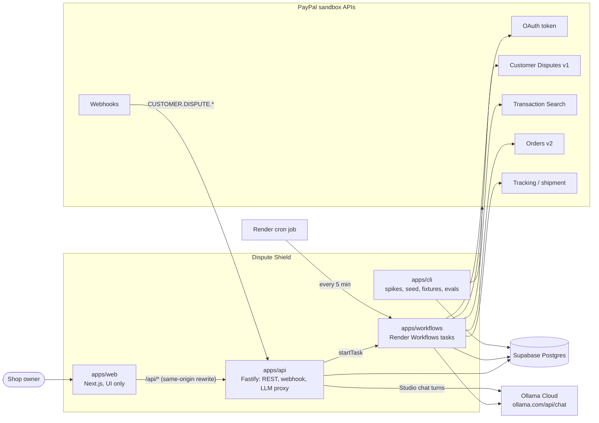
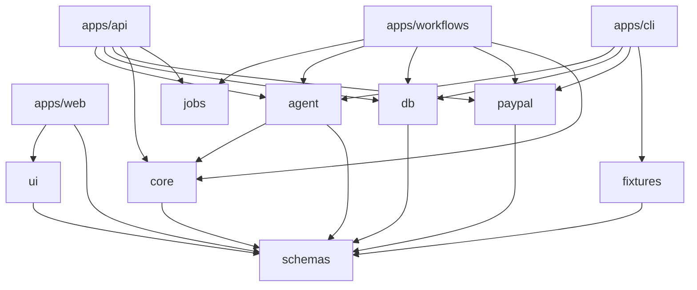
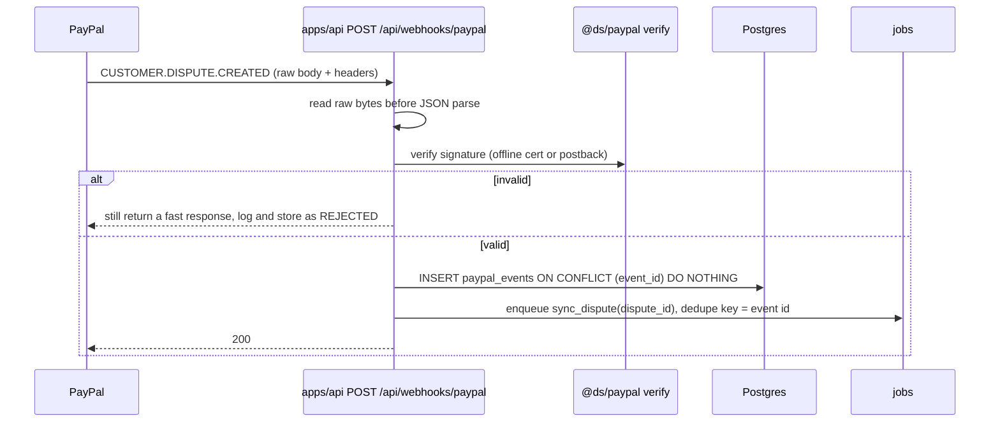
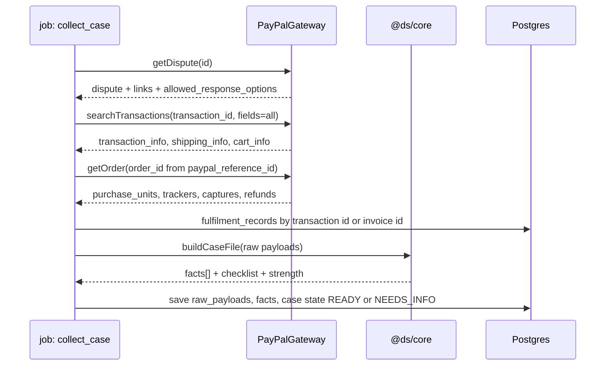
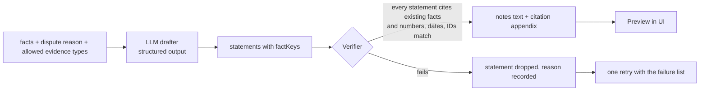
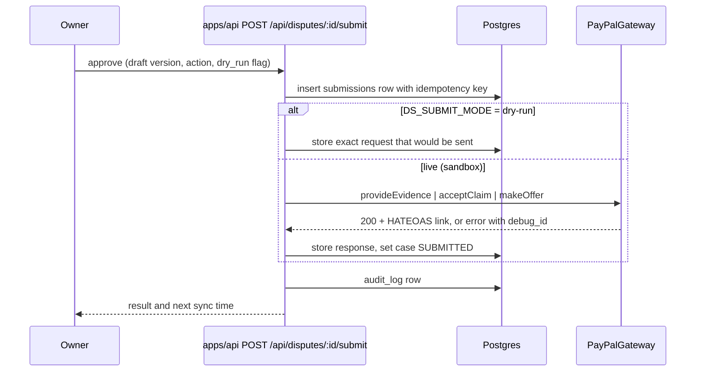
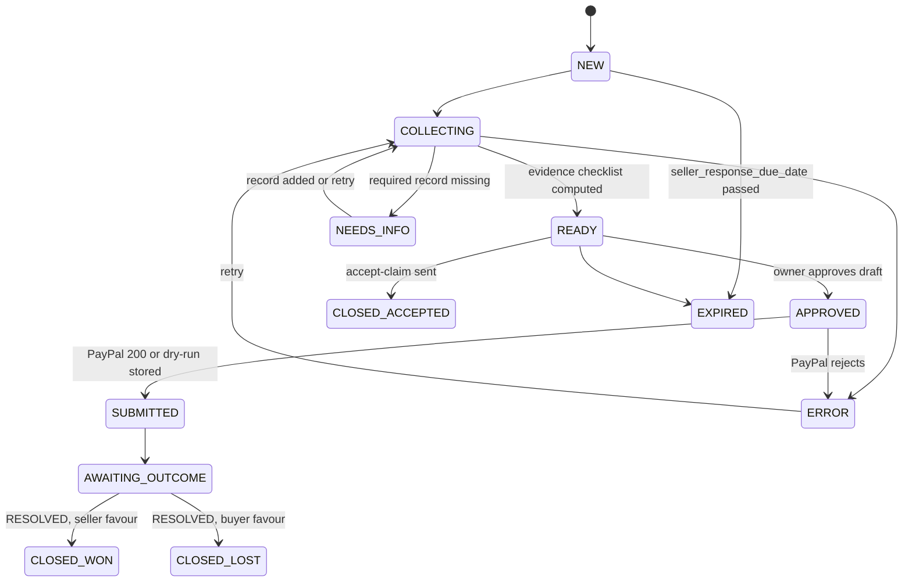

# Dispute Shield: Architecture

Status: draft v2 (adds the Fastify API service, Supabase, Ollama Cloud and the prize tracks), written 2026-10-17 (IST) for the PayPal AI Hackathon (submission closes 2026-11-13 01:30 IST).
Audience: the builder(s) and any coding agent working in the Turborepo.
Companion files: `02-monorepo-structure.md`, `03-paypal-api-contract.md`, `04-data-model.md`, `05-evidence-engine-spec.md`, `06-ui-spec.md`, `07-implementation-plan.md`, `13-api-service-spec.md` (the Fastify service), `14-prize-tracks.md` (the code-dependent prize categories).

## 0. Verification legend

Every PayPal or tooling fact in this pack carries one of three marks. Do not build on a fact marked ⚠️ or ❓ until a Day-0 spike (`11-risks-and-day0-spikes.md`) has confirmed it and the raw response is saved as a fixture.

| Mark | Meaning |
| --- | --- |
| ✅ | Read in PayPal, AG Grid or Turborepo documentation on 2026-10-17. Source listed in `03-paypal-api-contract.md`. |
| ⚠️ | Written from memory or from a third-party page. Likely right, not confirmed. |
| ❓ | Unknown or the docs conflict. Needs a spike. |

## 1. Purpose and scope

Dispute Shield is an open-source dispute desk for small online sellers who take payments with PayPal. It does two jobs:

1. **Respond.** When a buyer opens a dispute, build a case file from PayPal's own records, draft evidence in which every sentence cites a record, recommend fight or accept, and submit after the owner approves.
2. **Prevent.** Scan recent captured payments for the patterns that lose disputes (not fully seller-protected, no tracking, ship-to mismatch, stuck delivery) and offer a fix before a dispute opens.

Named user: the owner or ops person of a small online shop. Decisions: ship or hold an order; fight or accept a dispute.

Non-goals for the hackathon build: multi-tenant onboarding, live (production) PayPal calls, card-network chargebacks outside PayPal, ML win-probability, Shopify or other store connectors.

## 2. System context



Two job backends exist behind one `JobQueue` port (`DS_JOB_BACKEND`): `postgres` (rows in a `jobs` table, run by an in-process worker or the cron tick; the default for local runs and replay) and `render` (each job is a Render Workflows task run). The same handlers run on both (`@ds/jobs`).

## 3. Principles

1. **Facts are deterministic; prose is generated; a verifier gates the prose.** The model never supplies a fact. It arranges facts that code fetched from PayPal.
2. **Every claim cites a fact key.** A claim without a valid citation is dropped, not softened.
3. **Human approval before anything leaves the system.** No evidence, offer, refund or acceptance is sent without an explicit approve action.
4. **Ports and adapters at the PayPal boundary.** One `PayPalGateway` interface with a live adapter and a replay adapter. The same app runs against the sandbox or against recorded fixtures.
5. **Sandbox only.** The client hard-codes `https://api-m.sandbox.paypal.com`. There is no production switch.
6. **Webhooks are a hint, not the truth.** PayPal can deliver late, twice or out of order. Handlers store the event, then re-read current state from the API.
7. **Pure core.** Domain logic lives in `@ds/core` with no I/O so it can be tested in milliseconds.
8. **No invented numbers.** The UI shows amount at risk, due time and evidence coverage. It never shows a win probability.
9. **The browser holds no secrets and talks to one backend.** PayPal credentials, the Ollama key, the database URL and the Render key live only in `apps/api` and `apps/workflows`. `apps/web` renders and calls `apps/api`; it has no route handlers and no database access.
10. **The model can be missing.** Ollama Cloud has no structured-output mode ✅, so every model output is parsed and validated by code, and every model feature has a non-model fallback.

## 4. Containers and packages

| Unit | Path | Responsibility | May import |
| --- | --- | --- | --- |
| `@ds/web` | `apps/web` | Next.js app: UI only. Calls `apps/api`. No route handlers, no secrets, no DB. | `@ds/ui`, `@ds/schemas` |
| `@ds/api` | `apps/api` | Fastify 5 service: REST for the UI, PayPal webhook endpoint, cron tick, Studio LLM proxy, OpenAPI document. Spec: `13-api-service-spec.md`. | all server packages |
| `@ds/workflows` | `apps/workflows` | Render Workflows tasks, one per job kind, plus `process_dispute` that chains collect then draft. Prize track: `14-prize-tracks.md`. | `@ds/jobs`, server packages |
| `@ds/cli` | `apps/cli` | `ds` command: Day-0 spikes, sandbox seeding, fixture record and replay, eval runner | all packages |
| `@ds/schemas` | `packages/schemas` | zod schemas and inferred types for facts, drafts, API payloads, PayPal payload subsets | none |
| `@ds/core` | `packages/core` | Case-file builder, fact extraction, evidence checklists, verifier, decision aid, risk rules, state machines | `@ds/schemas` |
| `@ds/paypal` | `packages/paypal` | REST client, gateway interface, live and replay adapters, webhook verification, error taxonomy | `@ds/schemas` |
| `@ds/db` | `packages/db` | Drizzle schema, migrations, repositories, Postgres job queue | `@ds/schemas` |
| `@ds/jobs` | `packages/jobs` | Job kinds with zod payloads and `createJobRunner`; the single dispatch point for both job backends | none (zod only) |
| `@ds/agent` | `packages/agent` | Ollama Cloud client, Studio turn translation, LLM drafter, prompts, case copilot, PayPal toolkit wiring, eval harness | `@ds/schemas`, `@ds/core` |
| `@ds/ui` | `packages/ui` | Design tokens, React components, AG Grid wrappers, AG Studio wrapper (`src/studio`: proxy LLM adapter, Dispute analyst agent, custom widgets, theme) | `@ds/schemas` |
| `@ds/fixtures` | `packages/fixtures` | Redacted PayPal payloads, demo shop data, seed builders | `@ds/schemas` |
| `@ds/config-typescript` | `packages/config-typescript` | Shared `tsconfig` bases | none |
| `@ds/config-eslint` | `packages/config-eslint` | Shared flat ESLint config and boundary rules | none |

### 4.1 Dependency rules



- `@ds/core` and `@ds/schemas` must never import `@ds/paypal`, `@ds/db`, `@ds/agent` or any framework. Enforce with ESLint `no-restricted-imports` or `eslint-plugin-boundaries`.
- `@ds/ui` must not import server-only packages.
- `apps/web` must not import `@ds/db`, `@ds/paypal`, `@ds/agent`, `@ds/core` or `@ds/jobs`. It reaches them only through HTTP calls to `apps/api`.
- Handlers for job kinds are written once (in `@ds/core`, `@ds/paypal`, `@ds/db`, `@ds/agent` composition) and registered by both `apps/api` (Postgres worker) and `apps/workflows` (Render tasks).
- Apps compose packages; packages never import apps.

## 5. Key flows

### 5.1 Webhook intake



Notes:
- The PayPal page says to treat a notification as valid only when `verification_status` is `SUCCESS` ✅. The same page's text and its Node example disagree on the HTTP code to return when verification fails ❓. Decision: store the event as `REJECTED`, return 400, and rely on polling for the real state.
- Deduplicate on the event `id` with an atomic insert, not check-then-write ⚠️ (third-party guidance).
- Events can arrive out of order ⚠️, so the job re-reads the dispute with `GET /v1/customer/disputes/{id}` and never trusts the event body for state.
- Polling fallback: the cron tick lists disputes updated since the last sync (`update_time_after` ✅ parameter name, format ❓) so a missed webhook is recovered within five minutes.

### 5.2 Case collection (deterministic)



Each call stores its untouched response in `raw_payloads`. Facts point back to a payload and a JSON path, so a citation can always be traced to bytes PayPal returned.

Order lookup: the disputed ID is a transaction (capture) ID, not an order ID. The order ID comes from `transaction_info.paypal_reference_id` when `paypal_reference_id_type` is `ODR` ✅.

### 5.3 Draft and verify



Full rules are in `05-evidence-engine-spec.md`.

### 5.4 Approve and submit



Before sending, the handler re-reads the dispute and checks that the matching HATEOAS link (`provide-evidence`, `accept-claim`, `make-offer`) is present. If the link is missing the action is refused ✅ (PayPal says you cannot provide evidence without it).

### 5.5 Prevent scan

1. Cron or the "Scan now" button lists recent transactions with `GET /v1/reporting/transactions` (max 31 days per call, up to three hours of delay) ✅.
2. For each transaction not yet scanned, load `shipping_info`, `cart_info` and `protection_eligibility`.
3. Join the merchant's fulfilment record.
4. `@ds/core` evaluates rules R-PROT, R-ADDR, R-NOTRACK, R-STUCK, R-HIGH (thresholds in `05-evidence-engine-spec.md`) and writes `risk_flags`.
5. The owner picks an action per flag: add tracking, refund before dispute, dismiss. Each action goes through the same approve and audit path as a dispute submission.

### 5.6 Case copilot (should-have)

A chat panel on the case page. It runs a tool-using model (Ollama native tool calling ⚠️; spike S9) with PayPal read tools from `@paypal/agent-toolkit` restricted to `get_dispute`, `get_order`, `get_shipment_tracking`, `list_transactions` ✅ (names). Every tool result is written to `raw_payloads` and turned into facts, so the copilot's answers cite fact keys and pass through the same verifier. The copilot cannot write to PayPal.

## 6. Evidence pipeline data shapes

```ts
// @ds/schemas
export type Fact = {
  key: string;            // e.g. "txn.protection_eligibility", "tracking.number"
  label: string;          // human label shown in the UI
  value: string | number | boolean | null;
  display: string;        // exact string the verifier matches against
  sourcePayloadId: string;
  jsonPath: string;       // path inside the stored raw payload
  fetchedAt: string;      // ISO 8601
};

export type EvidenceStatement = {
  text: string;           // one sentence, no new facts
  factKeys: string[];     // at least one, all must exist in the case
};

export type EvidenceDraft = {
  evidenceType: "PROOF_OF_FULFILLMENT" | "PROOF_OF_REFUND" | "OTHER";
  statements: EvidenceStatement[];
  recommendation: {
    action: "FIGHT" | "ACCEPT" | "REVIEW";
    rationale: EvidenceStatement[];
  };
};

export type VerifierReport = {
  accepted: EvidenceStatement[];
  rejected: { statement: EvidenceStatement; reason: "NO_CITATION" | "UNKNOWN_FACT" | "VALUE_MISMATCH" | "TOO_LONG" }[];
  notesText: string;      // accepted statements joined, max 2000 chars
  citationAppendix: { factKey: string; label: string; display: string; payloadId: string; jsonPath: string }[];
};
```

`evidenceType` values are the three PayPal documents list ✅. The 2000-character limit on `notes` comes from PayPal's guide ✅.

## 7. PayPal gateway

```ts
// @ds/paypal
export interface PayPalGateway {
  listDisputes(q: { updateTimeAfter?: string; disputeState?: string; page?: number; pageSize?: number; nextPageToken?: string }): Promise<Raw<DisputeList>>;
  getDispute(id: string): Promise<Raw<DisputeDetails>>;
  provideEvidence(id: string, input: ProvideEvidenceInput, files?: EvidenceFile[]): Promise<Raw<Subsequent>>;
  acceptClaim(id: string, input: AcceptClaimInput): Promise<Raw<Subsequent>>;
  makeOffer(id: string, input: MakeOfferInput): Promise<Raw<Subsequent>>;
  searchTransactions(q: TxnQuery): Promise<Raw<TxnPage>>;
  getOrder(id: string): Promise<Raw<Order>>;
  addTracking(orderId: string, input: AddTrackingInput): Promise<Raw<unknown>>;       // path ⚠️
  refundCapture(captureId: string, input: RefundInput): Promise<Raw<unknown>>;       // path ⚠️
  verifyWebhook(headers: Headers, rawBody: string): Promise<{ ok: boolean; reason?: string }>;
}
// Raw<T> = { status: number; headers: Record<string,string>; body: T; debugId?: string; recordedAt: string }
```

Adapters:
- **LiveGateway**: OAuth client-credentials with token cache (sandbox tokens last about 3 to 8 hours ✅), refresh on 401, retry with exponential backoff on 429 and 5xx, honour `debug_id` from error bodies ✅ (error schema has `name`, `message`, `debug_id`), redact secrets in logs, optional recorder that writes each call to `packages/fixtures`.
- **ReplayGateway**: serves fixtures chosen by `(operation, scenario key)`. Scenario comes from `DS_SCENARIO` or the dispute ID. Lets judges run the full flow without PayPal credentials, and protects the demo from sandbox outages.

Error taxonomy: `AuthError`, `PermissionError` (403, missing scope), `NotFound`, `ValidationError` (400 with `details[]`), `RateLimited`, `UpstreamError`, `LinkMissing` (HATEOAS link absent).

## 8. State machines

### 8.1 Case



The PayPal dispute `status` (OPEN, WAITING_FOR_SELLER_RESPONSE, WAITING_FOR_BUYER_RESPONSE, UNDER_REVIEW, RESOLVED ✅) is stored separately in `disputes.paypal_status`. The case state is Dispute Shield's own workflow state and never overwrites it.

### 8.2 Submission

`PENDING → SENT | DRY_RUN_STORED | FAILED`. A failed submission keeps the PayPal `debug_id` and can be retried with the same idempotency key.

## 9. Jobs

One `JobQueue` port, two backends, one set of handlers.

**Handlers** (`@ds/jobs` defines kinds and zod payloads; `createJobRunner(handlers).run(kind, payload)` validates then dispatches). Kinds: `sync_disputes`, `sync_dispute`, `collect_case`, `draft_case`, `scan_transactions`, `record_fixture`. Payloads carry ids, never data. Every handler is idempotent: re-running `collect_case` replaces facts for the same case version.

**Backend `postgres`** (default; local, replay, tests): a `jobs` table in Supabase Postgres.
- Claim with `SELECT ... FOR UPDATE SKIP LOCKED`, `attempts` counter, `run_after` for backoff, `locked_by` and `locked_at` for crash recovery. Needs a session-mode or direct connection (see section 14).
- Runners: an in-process interval worker in `apps/api` (`DS_INLINE_WORKER`) and `POST /api/cron/tick` (protected by `CRON_SECRET`) for hosts that sleep when idle. The webhook handler and the UI "Sync now" button enqueue; they do not run jobs inline.

**Backend `render`** (hosted demo; prize track): each job kind is a Render Workflows task ✅. `apps/api` calls `startTask("<workflow-slug>/<kind>", [payload], { idempotencyKey })`. Render supplies retries (`retry: { maxRetries, waitDurationMs, backoffScaling }`), a per-run timeout, per-run compute and run history. `process_dispute` chains `collect_case` then `draft_case` with `ctx.run`, so a failed draft retries without redoing the PayPal collection and the pipeline never submits. Workflows have no native schedule ✅, so a Render cron job starts `sync_disputes` every five minutes. Idempotency: webhook-driven jobs pass the PayPal event id as `dedupeKey` (once only, Render keeps keys 24 h ✅); jobs without a key get a five-minute time bucket so a later sync is not swallowed by an earlier identical key.

Details and the task code outline: `14-prize-tracks.md` section 3.

## 10. LLM layer (Ollama Cloud)

- Provider: **Ollama Cloud**, native API `POST https://ollama.com/api/chat` with `stream: false`, and `GET /api/tags` for the health probe ✅. Auth is `Authorization: Bearer $OLLAMA_API_KEY` ✅. Model comes from `LLM_MODEL` (no default; choose in spike S9 from `/api/tags`). `OLLAMA_HOST` defaults to `https://ollama.com`; point it at a local Ollama (`http://localhost:11434`) to run offline.
- The key lives only on the server. The browser's AG Studio chat posts each turn to `POST /api/studio/llm/turn` on `apps/api`, which translates it to an Ollama chat request (`@ds/agent`, `createStudioTurnHandler`).
- **No structured outputs on cloud** ✅ (the docs list none, and the client never sends `format`). So: the drafter asks for JSON in the prompt, `extractJsonObject` pulls the object out of the text, zod validates it, one repair retry feeds back the failures, then the deterministic template fallback. The verifier still gates everything, so the safety argument does not depend on the model obeying a schema.
- **Tool calling** for the Studio analyst and the case copilot uses Ollama's native `tools` / `tool_calls` ⚠️. There is no `tool_choice` parameter ⚠️, so `toolChoice: required` is approximated in the prompt and `none` is done by sending no tools. Spike S9 confirms the model you pick supports tools.
- **Concurrency:** the free tier allows 1 concurrent request ✅, so the API serialises Studio turns per process and returns 429 with `Retry-After` when Ollama says so. The drafter runs in a workflow task, never in the web request.
- The drafter gets only facts (key, label, display), the dispute reason, the allowed evidence types and a style guide. It does not get raw payloads or buyer personal data.
- Prompts live in `packages/agent/src/prompts/` with a version string stored on each `drafts` row.
- Evals (`pnpm eval`): golden cases and adversarial cases (fabricated tracking number, wrong date, missing citation). The verifier must reject every fabricated case. Evals run against the real model only when `OLLAMA_API_KEY` is set; the deterministic suite always runs.
- Already implemented and tested in the pack: `packages/agent/src/llm/*` (client, errors, JSON extraction) and `studio/turn.ts`. Spec: `13-api-service-spec.md` section 7.

## 11. Frontend

- Next.js App Router, **UI only**. Versions to match PayPal's AG Studio starter on 2026-10-17: `next` 16.3.6, `react` 19.2.8, `ag-grid-community` and `ag-grid-react` 36.2.0, `ag-studio` and `ag-studio-react` 3.0.0, Tailwind 4, TypeScript 5 ✅ (starter's `package.json`).
- Data comes from `apps/api` through a typed client built on `@ds/schemas`. Server components may call the API with the request's cookie; there are no server actions that touch PayPal or the database.
- **Session across origins.** The session cookie is `SameSite=Lax`, which a browser will not send on a cross-site `fetch`. Default: `next.config` rewrites `/api/:path*` to `API_ORIGIN`, so the browser only ever talks to its own origin (cookie stays first-party, no CORS in production). Fallback if the rewrite times out on slow LLM turns ❓ (spike S12): the login response also returns a short-lived signed bearer token held in memory, and the Studio adapter sends it in `Authorization`. Do not switch to `SameSite=None` as the first fix: Safari and some Chrome settings drop third-party cookies.
- AG Grid powers the dispute queue and risk radar. **AG Studio** powers the Dispute Health dashboard and an in-dashboard **Dispute analyst** agent; the AG Grid prize judges custom widgets, theming and layout, and use of the Studio Agent Framework ✅. Design: `14-prize-tracks.md` section 2.
- Auth: single tenant. `DS_DEMO_ACCESS_CODE` gates the hosted demo with a signed cookie issued by `apps/api`. There is no sign-up flow. Production-grade merchant onboarding is a roadmap item, not a build item.
- Screens and behaviour: `06-ui-spec.md`.

## 12. Security and privacy

- Secrets only in environment variables; `.env.example` lists names, never values. CI fails on committed secrets. The browser bundle contains none: CI greps `apps/web/.next` for key prefixes and for `OLLAMA_API_KEY`.
- Sandbox only. The client has no production base URL; `DS_MODE=live` still talks to the sandbox.
- Raw payloads contain buyer data. Store only what the case needs; fixtures are redacted (names, emails, addresses replaced with synthetic values) before commit.
- The LLM sees fact displays, not raw payloads. Buyer names and emails are not included in prompts.
- Logs never contain tokens, client secrets or full payloads. Log PayPal `debug_id` instead.
- Webhooks: verify signature, reject unverified, deduplicate on event ID.
- Cron and webhook endpoints: secret or signature required; rate-limit by IP (`@fastify/rate-limit`: 300/min global, 10/min on login, 30/min on the LLM proxy). Helmet headers on every response. 1 MB body limit.
- The Studio analyst has a read-only tool allow-list (view schema, report, page, widget; run query). It has no tool that edits the dashboard and none that reaches PayPal, so a prompt-injected chat cannot submit anything.
- Supabase: the API uses the database role from `DATABASE_URL` only. Row Level Security is enabled on every table with no public policies, so the Supabase Data API (anon key) cannot read case data even if it is exposed ⚠️ (Supabase default behaviour; confirm in spike S11). The anon key is never used or shipped.
- Audit log rows are append-only (`audit_log`), written for every approve, submit, refund, add-tracking, dismiss and settings change.

## 13. Observability

- Structured logs (`pino`, Fastify's logger) with `requestId` (`x-request-id` honoured or generated), `jobId`, `disputeId`.
- `GET /api/health` reports mode (`live` or `replay`), submit mode, job backend, database state, LLM reachability (cached 60 s), last sync time, last webhook time, whether the inline worker runs. No secrets, ids or URLs.
- `GET /api/openapi.json` is the machine-readable API contract (APIMatic track).
- The UI Setup page shows the same data so a judge can see at a glance that the app is wired to the sandbox.

## 14. Deployment

| Profile | Web | API | Jobs | Database | LLM | Notes |
| --- | --- | --- | --- | --- | --- | --- |
| A, hosted demo (recommended) | Vercel, or Render | Render web service (`render.yaml`) | Render Workflows + Render cron | Supabase Postgres | Ollama Cloud | The hackathon gives $50 Render credits; the free web service spins down after 15 minutes idle (about 1 minute cold start) ✅. Use a paid instance for the Dec 1 to 15 judging window. |
| B, local | `pnpm dev` | `pnpm dev` (tsx watch) | in-process worker | `docker compose` Postgres or a Supabase project | Ollama Cloud key, or local Ollama, or none | What a judge runs from the README. Replay mode needs no credentials at all. |

**Supabase connection rules** ✅ (Supabase docs, read 2026-10-17). Three connection modes: direct (`db.<ref>.supabase.co:5432`, IPv6 only), shared pooler in **session mode** (port 5432, IPv4, supports prepared statements), and shared pooler in **transaction mode** (port 6543, no prepared statements, no advisory locks, no LISTEN). Pooled usernames are `postgres.<ref>`.
- `apps/api` and `apps/workflows` use the **session pooler or the direct connection**, because the jobs queue and migrations need session features. Render's outbound network may be IPv4-only ❓, so default to the session pooler.
- Do not use transaction mode with Drizzle's prepared statements unless `prepare: false` is set.
- **Free projects pause after low activity over 7 days** ✅ (restore possible within a year; paid projects are never paused). The 5-minute sync cron touches the database, which keeps it active; still check on Dec 1 and Dec 10. Free plan is 500 MB and 2 projects ✅.
- Migrations are plain Drizzle migrations run from `pnpm db:migrate` against the direct or session URL. Supabase-specific features (Auth, Storage, Realtime, the Data API) are not used; the app depends only on Postgres, so `docker compose` Postgres is a drop-in for local runs.

The hosted demo must stay up and free to use until the judging period ends (Dec 15) per the rules. Put a calendar reminder to check it on Dec 1 and Dec 10.

CI (`.github/workflows/ci.yml`): install, `turbo run lint typecheck test`, OpenAPI drift check (`pnpm openapi:check`), Playwright e2e in replay mode, secret scan. No scheduled GitHub workflow is needed when Render cron runs the sync; keep `cron-tick.yml` as an optional fallback for `DS_JOB_BACKEND=postgres` hosts.

## 15. Decision log

| ID | Decision | Alternatives | Why | Revisit if |
| --- | --- | --- | --- | --- |
| ADR-001 | Turborepo with pnpm workspaces | npm workspaces, Nx | Requested by the builder; simple task graph | Build times become a problem |
| ADR-002 | Internal packages consumed as source (just-in-time); `transpilePackages` in Next; `tsup` bundles `@ds/*` into the API and workflow outputs | Compiled packages with `build` | No build step per package; one bundle per deployable | A package needs publishing |
| ADR-003 | Postgres + Drizzle, hosted on Supabase (Postgres only) | SQLite, Neon | Row locking for jobs, JSONB for raw payloads; Supabase free tier is enough and the code stays portable | Free-project pause becomes a problem; use paid or move host |
| ADR-004 | One `JobQueue` port: Postgres jobs table (default) and Render Workflows (hosted); cron by Render | pg-boss, Redis/BullMQ, GitHub Actions cron | No extra infra locally; Render Workflows gives retries and run history and is a prize track | Render Workflows limits or pricing bite |
| ADR-005 | Direct REST client for disputes, tracking and refunds; toolkit only for the copilot's read tools | Toolkit for everything | The toolkit has no evidence or payouts tools (its dispute tools are `list_disputes`, `get_dispute`, `accept_dispute_claim`) ✅; REST depth is what the first judging criterion rewards | Toolkit adds evidence tools |
| ADR-006 | Citation-enforced drafting with a deterministic verifier | Free-form generation | Makes the "auditable" claim true and testable | None |
| ADR-007 | Replay adapter and fixtures from day one | Live only | Judges can run it; protects demo from sandbox flakiness | None |
| ADR-008 | No win probability | Model-estimated odds | Not defensible with no outcome data | We collect real outcomes |
| ADR-009 | Single tenant, access-code demo login | Full auth | Time; the rules need a working demo, not onboarding | Post-hackathon |
| ADR-010 | AG Grid Community for the queue from day one; AG Studio trial started late | Studio from day one | Trial is 45 days ✅ and judging runs to Dec 15; start it about Nov 1 so it covers judging | AG Grid confirms a longer licence |
| ADR-011 | Human approval required for every outbound action | Auto-submit | Safety, and a better story | None |
| ADR-012 | Fail closed to template evidence when the model fails | Fail open | An outage must not block a response deadline | None |
| ADR-013 | Separate Fastify service `apps/api`; Next.js is UI only | Next.js route handlers | Clear secret boundary, independently deployable, an OpenAPI contract to generate SDKs from, webhook handling without a UI framework in the way | Two deployables cost too much ops time |
| ADR-014 | Ollama Cloud for the LLM; validate in code, no reliance on structured output | Provider-agnostic SDK, Anthropic/OpenAI | Builder's choice; cloud has no structured outputs ✅, so the verifier plus parse/repair/fallback carry safety | A model with reliable JSON mode is adopted |
| ADR-015 | Browser reaches the API through a same-origin rewrite; bearer-token fallback | `SameSite=None` cross-site cookie | Keeps the cookie first-party; third-party cookies are blocked in some browsers | The rewrite times out on long LLM turns (S12) |
| ADR-016 | AG Studio chat talks to our API, which calls Ollama (custom `AgLlmAdapter`) | Calling Ollama from the browser | The key stays server-side; one place to rate limit and log | Streaming is needed (Ollama call is `stream:false` now) |
| ADR-017 | Studio analyst is read-only by construction (tool allow-list) | Let the agent edit the dashboard | A chat cannot change the report or touch PayPal | None |

## 16. Open questions

Tracked with owners and spikes in `11-risks-and-day0-spikes.md`. The ones that can change the architecture:

1. Can a sandbox dispute be created and walked to `WAITING_FOR_SELLER_RESPONSE` without PayPal's account manager? (S1 to S3)
2. What is the exact multipart shape of `provide-evidence`? The guide describes an `input` JSON part plus document parts; the API schema shows a single binary field `evidence-file` ❓. (S3)
3. Do order details return trackers and capture or refund fields in the shape this design assumes? (S7)
4. Does AG Studio need a licence key at runtime in development, and what does it show when the trial lapses? ❓ (S10)
5. Does the custom widget API accept the "Deadline runway" and "Verifier ledger" widgets, and does an `AgLlmAdapter` backed by our proxy work end to end with the Dispute analyst? (S10)
6. Does `render.yaml` apply cleanly (web + `type: workflow` + cron), and does `startTask` from the API reach the workflow? Does Supabase's session pooler work from Render, and does the Data API stay closed? (S11)
7. Does the same-origin rewrite carry a 60 s LLM turn, or is the bearer-token fallback needed? (S12)
8. Which Ollama Cloud model supports tool calling and follows the JSON prompt reliably, and is API access available on the free tier? ❓ (S9)

## 17. Glossary

- **Case**: Dispute Shield's workflow record for one PayPal dispute.
- **Fact**: one value extracted from a stored PayPal payload, with a key and a path back to the payload.
- **Statement**: one sentence of generated evidence that cites fact keys.
- **Verifier**: deterministic code that accepts or rejects statements.
- **Job backend**: where background jobs run, `postgres` or `render`; chosen by `DS_JOB_BACKEND`.
- **Dispute analyst**: the read-only AG Studio chat agent on the Health dashboard.
- **Replay mode**: running the app against recorded fixtures instead of live sandbox calls.
- **Strength**: STRONG, MEDIUM or WEAK evidence coverage from a fixed checklist; not a probability.